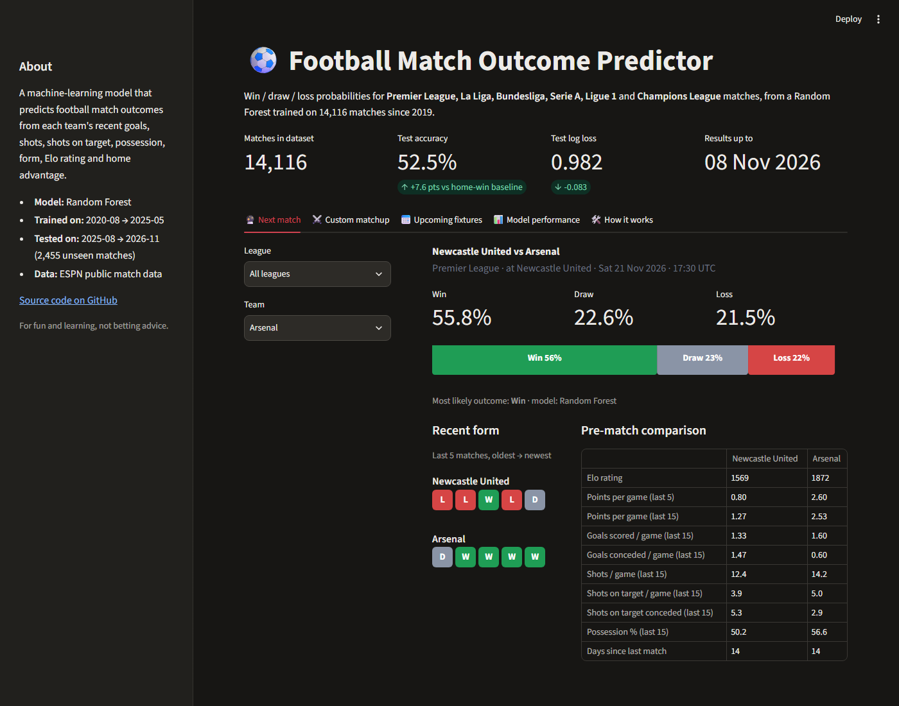

# ⚽ Football Match Outcome Predictor

A machine-learning web app that predicts **win / draw / loss** probabilities for football matches in the
Premier League, La Liga, Bundesliga, Serie A, Ligue 1 and the UEFA Champions League. The model is trained
on **14,000+ matches since 2019**. Its features are each team's recent goals, shots, shots on target,
possession, form, Elo rating and home advantage.



## Features
- **Next match:** pick any team and see its next fixture with win/draw/loss probabilities, recent form and
  a side-by-side stat comparison.
- **Custom matchup:** any two teams, at either stadium or a neutral venue, in a league or Champions League game.
- **Upcoming fixtures:** predictions for every scheduled match in the next few weeks.
- **Model performance:** test-set metrics compared with baselines, feature importance, confusion matrix and
  calibration.

## How it works

```
ESPN public API ──► fetch_data.py ──► data/matches.csv ──► features.py ──► train.py ──► models/model.joblib
                                                                                           │
                                                          app.py (Streamlit)  ◄── predictor.py ──► predict.py (CLI)
```

1. **Data collection** (`fetch_data.py`): every match since 2019-20 with score, possession, shots, shots on
   target, corners and fouls, plus upcoming fixtures. Downloads are cached per match day and fetched in parallel.
2. **Feature engineering** (`features.py`): 58 pre-match features per match. Each one uses **only matches
   finished before kickoff**, so the result can't leak into its own prediction:
   - rolling averages over the last 5 and 15 matches of goals scored and conceded, shots for and against,
     shots on target for and against, possession, and points per game (form)
   - an **Elo rating** updated after every match. Champions League games put teams from different leagues
     on one scale.
   - home advantage (switched off at neutral venues), days of rest, a Champions League flag and
     home-minus-away differences
3. **Model training** (`train.py`): a Random Forest and XGBoost tuned with `GridSearchCV` +
   `TimeSeriesSplit`, optimising log loss. The split is chronological and never shuffled. The model with the
   better cross-validation score is kept and refit on all labelled data.
4. **Serving** (`app.py`, `predict.py`): a Streamlit web app and a command-line tool built on one shared
   `predictor.py` module.

## Results
Trained on 2020-21 to 2024-25 (9,515 matches) and tested on 2025-26 plus 2026-27 to date (2,455 matches the
model never saw):

| Model | Accuracy | Log loss ↓ | Brier ↓ |
|---|---|---|---|
| Baseline: always home win | 45.0% | 1.066 | 0.644 |
| Baseline: Elo-only logistic regression | 52.8% | 0.984 | 0.585 |
| **Random Forest** (selected by CV) | 52.6% | 0.982 | 0.584 |
| XGBoost | 52.9% | 0.981 | 0.583 |

**Takeaways**
- About 53% accuracy on a three-way outcome. Bookmakers typically reach about 53–55%, so the ceiling is low.
- Elo difference and the shots-on-target difference are the strongest features.
- The tree models beat the home-win baseline by 8 points but only slightly beat Elo alone. Most of the
  predictable signal is team strength.
- Draws (25% of matches) are almost never the single most likely outcome, a known difficulty in football
  prediction. The draw probabilities themselves are well calibrated.

## Run it locally

```bash
python -m venv .venv
.venv/Scripts/activate            # macOS/Linux: source .venv/bin/activate
pip install -r requirements.txt
streamlit run app.py
```

Refresh the data and retrain (optional):

```bash
python fetch_data.py     # downloads new results and fixtures (~5 min first run, fast afterwards)
python train.py          # tunes and trains both models (~5 min)
```

Command-line predictions:

```bash
python predict.py "Arsenal"
python predict.py "Real Madrid" --opponent "Bayern" --venue away --ucl
python predict.py --upcoming --days 7
```

## Deploy (free) on Streamlit Community Cloud
1. Sign in at [share.streamlit.io](https://share.streamlit.io) with GitHub.
2. Click **Create app**, choose this repository, branch `main` and main file `app.py`.
3. In **Advanced settings**, choose Python 3.12 or newer, then deploy.

## Tech stack
Python · pandas · NumPy · scikit-learn · XGBoost · Streamlit · Altair

## Project structure
| File | Purpose |
|---|---|
| `fetch_data.py` | Data collection from ESPN's public API |
| `features.py` | Leakage-free feature engineering and Elo ratings |
| `train.py` | Hyperparameter tuning, evaluation and model selection |
| `predictor.py` | Prediction logic shared by the app and the CLI |
| `app.py` | Streamlit web app |
| `predict.py` | Command-line interface |
| `reports/metrics.json` | Full evaluation results |

*Built for learning. Not betting advice.*
